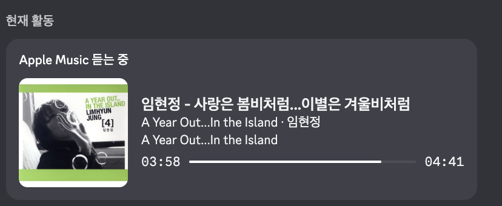

# Apple Music Discord Presence

[English](README.md) · **한국어**

[](https://github.com/qtaghdi/apple-music-discord-presence/actions/workflows/ci.yml)

Apple Music에서 듣는 음악을 **앨범 커버·재생바와 함께 Discord에 표시**합니다. macOS와 Windows를 지원하며, 일시정지하면 기본적으로 활동을 숨깁니다.



*macOS의 실제 Discord 화면입니다. Apple Music으로 이동하는 버튼은 다른 사람이 내 프로필을 볼 때 표시됩니다.*

**다운로드 → 설치 → 음악 재생.** Application ID 입력, Discord 로그인, 봇 토큰, Node.js 설치가 필요하지 않습니다.

[macOS용 다운로드](https://github.com/qtaghdi/apple-music-discord-presence/releases/latest/download/apple-music-discord-presence-macos-arm64.zip) · [Windows용 다운로드](https://github.com/qtaghdi/apple-music-discord-presence/releases/latest/download/apple-music-discord-presence-windows-x64.zip) · [한국어 웹사이트](https://qtaghdi.github.io/apple-music-discord-presence/?lang=ko)

마음에 드셨다면 [GitHub에서 스타를 눌러주세요](https://github.com/qtaghdi/apple-music-discord-presence).

## 설치와 실행

ZIP에 실행용 Node.js가 포함되어 있어 사용자 PC에 개발 도구를 설치할 필요가 없습니다.

1. 내 운영체제에 맞는 ZIP을 다운로드하고 압축을 풉니다.
2. macOS는 `Install.command`, Windows는 `Install.cmd`를 실행합니다. 공용 Discord 앱이 자동으로 연결됩니다.
3. macOS에서 Music 접근을 요청하면 허용합니다. Apple Music과 Discord 데스크톱 앱을 켜고 음악을 재생합니다.

- **macOS:** `~/Applications`에 앱이 설치됩니다. 상단 메뉴 막대의 **음표 아이콘 → 설정 열기**를 누르세요. 종료 후에는 Finder의 사용자 응용 프로그램 폴더나 Spotlight에서 **Apple Music Discord Presence**를 실행하면 됩니다.
- **Windows:** 압축을 푼 폴더를 계속 보관하세요. 시작 메뉴에 **Apple Music Discord Presence** 바로가기가 생깁니다. **트레이 아이콘 우클릭 → Open Settings**로 설정을 엽니다. 숨겨진 아이콘 화살표 안에 있을 수 있으며, 아이콘을 두 번 클릭해도 설정이 열립니다.
- 아이콘 메뉴에서 연결 상태 확인, 재연결, 로그 폴더 열기, 로그인 시 자동 실행, 종료를 사용할 수 있습니다. **종료**와 **로그인 시 자동 실행 끄기**는 별개입니다.
- 기존의 `Settings.command` / `Settings.cmd`로도 설정을 열 수 있습니다.

macOS 앱은 임시 서명(ad-hoc signing)을 사용하며 Apple 공증을 받지 않았습니다. 처음 실행할 때 **시스템 설정 → 개인정보 보호 및 보안**에서 실행 허용이 필요할 수 있습니다.

## 주요 기능

- 현재 곡, 아티스트, 앨범, 재생 위치, 곡 변경 및 일시정지를 반영합니다.
- macOS에서는 Swift와 ScriptingBridge로 Music 앱을 직접 읽습니다. JXA를 사용하지 않습니다.
- Windows에서는 Windows 미디어 제어 API를 통해 **Apple Music 세션만** 읽습니다.
- 로컬 Discord IPC로 직접 연결하며 `discord-ipc-0`부터 `discord-ipc-9`까지 지원합니다. Discord 재시작 후 자동으로 연결하고 활동을 복원합니다.
- 앨범명·커버·재생바·Apple Music 버튼·일시정지 중 표시·정보 순서를 설정할 수 있습니다.
- 설정 화면에서 저장하면 앱을 재시작하지 않아도 반영됩니다.
- 앨범 커버는 Apple의 공개 검색 API에서 선택적으로 가져옵니다. 검색이 실패해도 곡 정보 표시는 계속됩니다.
- 실행 시 추가 npm 의존성, 중계 서버, 분석 도구, 봇 토큰, 클라이언트 시크릿, Discord OAuth 로그인이 없습니다.

Discord 상태 목록에는 **아티스트 - 곡 제목**이 표시됩니다. Discord 자체가 카드 제목과 기본 아이콘을 결정하므로 프로필 카드 상단에는 **Apple Music 듣는 중**이 표시될 수 있습니다.

## 지원 환경

- Apple Silicon Mac, macOS 13 이상
- Windows 10 버전 1809 이상 또는 Windows 11, x64
- Apple Music 및 Discord 데스크톱 앱

기본 공용 Application ID가 포함되어 있습니다. 고급 사용자는 개인 Application ID로 변경할 수 있지만 **봇 토큰이나 클라이언트 시크릿을 설정 파일에 넣으면 안 됩니다.**

## 한국어·영어 전환

랜딩과 설정 화면 상단의 **한국어 / English** 선택 메뉴를 사용하세요. 첫 방문에는 브라우저 언어에 맞춰 표시하며, 직접 고른 언어를 해당 사이트의 브라우저 저장소에 기억합니다. 저장소 사용이 차단되어도 언어 선택은 작동합니다.

`?lang=ko` 또는 `?lang=en`으로 특정 언어를 바로 열 수 있습니다. 언어 변경은 음악 표시 옵션을 바꾸거나 자동 저장하지 않습니다. 곡 제목·아티스트·앨범명은 Music 앱의 원래 정보를 유지합니다.

- [한국어 랜딩](https://qtaghdi.github.io/apple-music-discord-presence/?lang=ko)
- [한국어 로컬 설정](http://127.0.0.1:47621/?lang=ko) — 앱 실행 중에만 접속 가능

## 설정

설정 화면은 앱 실행 중 이 컴퓨터의 `http://127.0.0.1:47621`에서만 제공됩니다. 외부 서버나 계정이 없으며 인터넷에 공개되는 포트도 없습니다. 설정 화면에서는 Application ID를 변경하지 않습니다.

| 항목 | 동작 |
| --- | --- |
| 앨범명 | 아티스트와 함께 앨범명을 표시합니다. |
| 앨범 커버 | 검색 결과가 있으면 표지를 표시합니다. |
| 재생바 | 현재 재생 위치와 곡 전체 길이를 전달합니다. |
| Apple Music으로 이동 | 곡 링크를 찾으면 이동 버튼을 추가합니다. 본인 프로필에서는 버튼이 보이지 않습니다. |
| 일시정지 중에도 표시 | 켜면 멈춘 뒤에도 활동이 남습니다. **멈췄을 때 활동을 숨기려면 꺼두세요.** 새 설치의 기본값은 꺼짐입니다. |
| 정보 표시 순서 | 아티스트 → 앨범 또는 앨범 → 아티스트를 선택합니다. |

### 고급 설정 파일

`AMDP_CONFIG`가 있으면 우선 사용하고, 이후 운영체제별 경로와 대체 경로를 확인합니다.

- macOS: `~/Library/Application Support/Apple Music Discord Presence/config.json`
- Windows: `%APPDATA%\Apple Music Discord Presence\config.json`
- 대체 경로: `~/.config/apple-music-discord-presence/config.json`

`DISCORD_CLIENT_ID` 환경변수는 파일의 ID보다 우선합니다. 둘 다 없으면 프로젝트 소유자가 선택한 공개 공용 ID `1562487067424854017`을 사용합니다. 기존 개인 ID는 유지됩니다.

```json
{
  "pollIntervalMs": 1000,
  "showPaused": false,
  "presence": {
    "showAlbum": true,
    "showTimeRemaining": true,
    "showButton": true,
    "displayOrder": "artist-album"
  },
  "artwork": { "enabled": true, "country": "KR" }
}
```

직접 파일을 바꾼 뒤에는 메뉴의 **다시 연결 / Reconnect**를 선택하세요. 설정 화면에서 저장한 변경은 즉시 반영됩니다. 업그레이드 시 기존 설정은 유지됩니다.

`fallbackLargeImageKey`는 선택 사항입니다. 사용하려면 해당 Discord 애플리케이션의 Rich Presence 이미지 자산에 같은 키의 이미지를 등록하세요.

## 문제 해결

### Discord에 활동이 나타나지 않을 때

- 브라우저 버전 대신 Discord 데스크톱 앱을 사용하세요.
- Discord **사용자 설정 → 활동 개인정보**에서 활동 공유를 켜세요.
- Discord를 완전히 종료했다가 다시 열어보세요. 앱은 자동 재연결합니다.
- 다른 Rich Presence 도구가 실행 중이면 잠시 종료하세요.
- 개인 Application ID를 지정했다면 숫자 ID가 맞는지 확인하세요.

### 설정 화면이 열리지 않을 때

설치 후 macOS는 `~/Applications`, Windows는 시작 메뉴에서 앱을 다시 실행하세요. 메뉴 막대·트레이에서 설정을 엽니다. 앱이 켜져 있을 때만 `127.0.0.1:47621`에 접속할 수 있습니다. 같은 포트를 다른 프로그램이 사용 중이면 로그를 확인하세요.

### macOS에서 곡 정보를 못 읽을 때

**시스템 설정 → 개인정보 보호 및 보안 → 자동화**에서 **Apple Music Discord Presence**가 Music에 접근하도록 허용하세요. 소스로 실행할 때에는 터미널의 권한을 확인하세요.

직접 Node를 실행하는 소스용 LaunchAgent는 Node의 자동화 권한 선언에 따라 차단될 수 있어 패키지 앱을 권장합니다. `./bin/music-metadata --once`로 진단 정보를 출력하고 권한 요청을 확인할 수 있습니다. 서명되지 않은 도우미를 다시 빌드하면 권한을 다시 물을 수 있습니다.

### Windows에서 곡 정보를 못 읽을 때

Microsoft Store의 Apple Music 앱을 사용하고 음악을 먼저 재생하세요. 진단 명령은 다음과 같습니다.

```powershell
powershell.exe -ExecutionPolicy Bypass -File native\MusicMetadata.ps1 -Once
```

로그는 `%LOCALAPPDATA%\Apple Music Discord Presence\Logs`에 저장됩니다.

### 앨범 커버가 없을 때

`itunes.apple.com`에 HTTPS로 접근할 수 있어야 합니다. 설정된 국가와 미국 카탈로그를 검색하며, 한영 표기 차이는 아티스트·곡 길이로 확인합니다. 정확한 앨범을 찾으면 커버만 사용할 수도 있습니다. 앨범 검색만 일치한 경우 다른 곡 링크를 만들지 않습니다. 로컬 파일이나 특정 지역 음원은 검색되지 않을 수 있으며, 이 경우에도 텍스트 활동은 유지됩니다.

### Apple Music 이동 버튼이 없을 때

Discord는 본인 프로필에서 버튼을 숨깁니다. 다른 계정에서 확인하세요. 곡 링크를 찾지 못한 경우에도 버튼이 생기지 않습니다.

## 개발과 배포

개발에는 Node.js 20 이상이 필요합니다. macOS에서는 Xcode Command Line Tools도 필요합니다.

```sh
git clone https://github.com/qtaghdi/apple-music-discord-presence.git
cd apple-music-discord-presence
npm install
npm run verify
npm start
```

`npm run verify`는 Swift 빌드, 엄격한 TypeScript 검사, 단위 테스트를 실행하는 필수 커밋 전 검사입니다. Windows에서는 `npm run build:ts`와 `npm test`를 실행합니다.

소스용 자동 실행은 `npm run install-agent`, 해제는 `npm run uninstall-agent`입니다. 이 방식에는 메뉴 막대 아이콘이 없으며 저장소 경로를 유지해야 합니다.

- macOS ZIP: `npm run verify && ./scripts/package-macos.sh`
- Windows ZIP: `npm run build:ts`, `npm test`, `./scripts/package-windows.ps1`

macOS와 Windows CI에서 빌드·테스트를 검사합니다. `v*` 태그는 ZIP과 GitHub Release를 생성하고, `site/`는 GitHub Pages에 배포됩니다. 버전별로 `CHANGELOG.md`, `releases/vX.Y.Z.md`, 패키지 버전을 맞춰야 합니다. 로그인된 Music·Discord와 권한이 필요한 전체 연결 테스트는 수동으로 진행합니다.

## 업데이트와 제거

업데이트 전에는 아이콘 메뉴에서 앱을 종료하고 새 ZIP의 설치 파일을 실행하세요. 기존 설정은 유지됩니다.

제거하려면 로그인 시 자동 실행을 끄고 앱을 종료하세요. macOS는 `~/Applications/Apple Music Discord Presence.app`을 휴지통으로 옮깁니다. Windows는 `Uninstall.cmd`로 시작 메뉴와 자동 실행 등록을 제거한 뒤 압축을 푼 폴더를 삭제합니다. 설정과 로그는 남습니다.

## 개인정보

커버나 Apple Music 버튼이 켜져 있으면 아티스트·앨범·제목을 Apple의 iTunes Search API에 보내 검색합니다. 둘 다 끄려면 `artwork.enabled`와 `presence.showButton`을 `false`로 설정하세요. Discord에는 표시할 재생 정보가 전달됩니다. Apple Music 토큰, Discord 봇 토큰, 분석 도구, 중계 서버는 사용하지 않습니다.

언어 선택은 각 페이지의 브라우저 저장소에만 저장되며, 음악 표시 설정과 별개입니다.

## 라이선스

[MIT](LICENSE). 독립 프로젝트이며 Apple 및 Discord와 제휴하지 않습니다.
